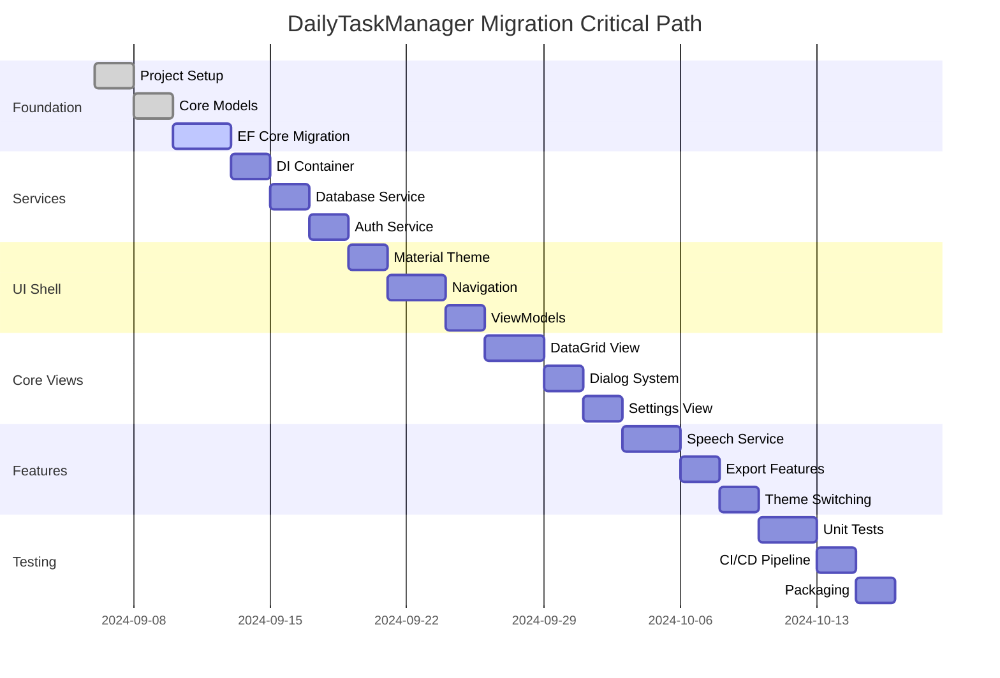

# WPF → Avalonia Cross-Platform Migration Guide
## DailyTaskManager Migration Strategy

---

## Table of Contents
1. [Migration Strategy](#1-migration-strategy)
2. [WPF→Avalonia Mapping Table](#2-wpfavalonia-mapping-table)
3. [Repository Skeleton](#3-repository-skeleton)
4. [Sample Code](#4-sample-code)
5. [CI/CD Pipeline](#5-cicd-pipeline)
6. [Build Scripts](#6-build-scripts)
7. [Testing Strategy](#7-testing-strategy)
8. [Performance, Accessibility, i18n](#8-performance-accessibility-i18n)
9. [Risk Assessment & Timeline](#9-risk-assessment--timeline)
10. [Next Steps](#10-next-steps)

---

## 1. Migration Strategy

### Current Architecture Analysis

**Existing Stack:**
- **Framework**: .NET Framework 4.8 WPF
- **UI**: MaterialDesignThemes.Wpf 5.2.1
- **Data**: Entity Framework 6.5.1 + PostgreSQL (Npgsql 4.1.14)
- **Architecture**: MVVM pattern with manual INotifyPropertyChanged
- **Dependencies**: ClosedXML, iTextSharp, System.Speech, BCrypt.Net-Next

**Target Stack:**
- **Framework**: .NET 8+ Avalonia 11+
- **UI**: Material.Avalonia themes
- **Data**: Entity Framework Core 8+ + PostgreSQL
- **Architecture**: MVVM with Microsoft.Extensions.Hosting + DI
- **Dependencies**: Modern cross-platform equivalents

### Gap Analysis & Replacements

| WPF Feature | Avalonia Equivalent | Migration Notes |
|------------|-------------------|-----------------|
| **MaterialDesignThemes.Wpf** | **Material.Avalonia** | Direct theme migration possible |
| **Microsoft.Xaml.Behaviors** | **Avalonia.Xaml.Interactions** | Behavior patterns similar |
| **DependencyProperty** | **StyledProperty/DirectProperty** | API changes required |
| **System.Speech** | **Platform-specific services** | Cross-platform abstraction needed |
| **WPF DataGrid** | **Avalonia DataGrid** | Virtualization differences |
| **File Dialogs** | **Avalonia.Storage** | Platform service pattern |
| **Entity Framework 6** | **Entity Framework Core 8** | Connection string migration |

### Layered Architecture Plan

```
┌─────────────────────────────────────────────────────────────┐
│                    Presentation Layer                       │
├─────────────────────┬───────────────────┬───────────────────┤
│   App.Avalonia      │   App.Wpf.Legacy  │    Future: Mobile │
│     (net8.0)        │     (net48)       │   Android/iOS    │
└─────────────────────┴───────────────────┴───────────────────┘
┌─────────────────────────────────────────────────────────────┐
│                 Application Services Layer                  │
├─────────────────────────────────────────────────────────────┤
│               App.Services (net8.0)                        │
│   Navigation, Authentication, File Operations, Speech       │
└─────────────────────────────────────────────────────────────┘
┌─────────────────────────────────────────────────────────────┐
│                   Business Logic Layer                      │
├─────────────────────────────────────────────────────────────┤
│               App.Core (netstandard2.0)                    │
│      Models, Interfaces, Domain Services                    │
└─────────────────────────────────────────────────────────────┘
┌─────────────────────────────────────────────────────────────┐
│                  Infrastructure Layer                       │
├─────────────────────────────────────────────────────────────┤
│            App.Infrastructure (net8.0)                     │
│     EF Core, Database, Export Services, OAuth              │
└─────────────────────────────────────────────────────────────┘
```

### Migration Phases

#### **Phase 1: Foundation Setup (Week 1)**
1. **Project Creation**: Create new Avalonia solution structure
2. **Dependencies**: Update NuGet packages to .NET 8 equivalents
3. **Core Migration**: Extract and port business models to netstandard2.0
4. **Database**: Migrate from EF6 to EF Core with same PostgreSQL schema

#### **Phase 2: Service Layer (Week 2)**
1. **DI Container**: Replace ServiceContainer with Microsoft.Extensions.DependencyInjection
2. **Database Service**: Port DatabaseService to async/await patterns with EF Core
3. **Authentication**: Port authentication with cross-platform OAuth
4. **Export Services**: Update ClosedXML and PDF export for cross-platform

#### **Phase 3: UI Shell & Navigation (Week 3)**
1. **App.axaml**: Create Avalonia application with Material theme
2. **MainWindow**: Port navigation shell with ContentControl pattern
3. **ViewModels**: Convert ViewModels to use ReactiveUI or CommunityToolkit.Mvvm
4. **Routing**: Implement navigation store pattern for view switching

#### **Phase 4: Core Views (Week 4)**
1. **DailyTasksView**: Port DataGrid with Material.Avalonia styling
2. **Authentication Views**: Port LoginWindow with cross-platform OAuth
3. **Settings View**: Port configuration management
4. **Dialogs**: Convert modal dialogs to Avalonia patterns

#### **Phase 5: Advanced Features (Week 5)**
1. **Speech Recognition**: Implement platform-specific services
2. **File Operations**: Port file dialogs and export functionality
3. **Themes**: Implement light/dark theme switching
4. **Validation**: Port validation logic to Avalonia patterns

#### **Phase 6: Testing & Deployment (Week 6)**
1. **Unit Tests**: Comprehensive ViewModel and service testing
2. **Integration Tests**: Database and service integration tests  
3. **CI/CD**: Multi-platform build pipeline
4. **Packaging**: Create installers for Windows/macOS/Linux

---

## 2. WPF→Avalonia Mapping Table

### DependencyProperty → StyledProperty/DirectProperty

**WPF:**
```csharp
public static readonly DependencyProperty MyPropertyProperty =
    DependencyProperty.Register("MyProperty", typeof(string), typeof(MyControl));

public string MyProperty
{
    get => (string)GetValue(MyPropertyProperty);
    set => SetValue(MyPropertyProperty, value);
}
```

**Avalonia:**
```csharp
public static readonly StyledProperty<string> MyPropertyProperty =
    AvaloniaProperty.Register<MyControl, string>(nameof(MyProperty));

public string MyProperty
{
    get => GetValue(MyPropertyProperty);
    set => SetValue(MyPropertyProperty, value);
}
```

### Bindings & Converters

**WPF:**
```xml
<TextBlock Text="{Binding Description, UpdateSourceTrigger=PropertyChanged}"
           Visibility="{Binding IsVisible, Converter={StaticResource BooleanToVisibilityConverter}}"/>
```

**Avalonia:**
```xml
<TextBlock Text="{Binding Description}"
           IsVisible="{Binding IsVisible}"/>
```

### Commands & Gestures

**WPF:**
```xml
<Button Command="{Binding SaveCommand}" CommandParameter="{Binding SelectedItem}">
    <Button.InputBindings>
        <KeyBinding Key="S" Modifiers="Ctrl" Command="{Binding SaveCommand}"/>
    </Button.InputBindings>
</Button>
```

**Avalonia:**
```xml
<Button Command="{Binding SaveCommand}" CommandParameter="{Binding SelectedItem}"
        HotKey="Ctrl+S"/>
```

### Resource Dictionaries & Theming

**WPF App.xaml:**
```xml
<Application.Resources>
    <ResourceDictionary>
        <ResourceDictionary.MergedDictionaries>
            <materialDesign:BundledTheme BaseTheme="Light" PrimaryColor="DeepPurple"/>
        </ResourceDictionary.MergedDictionaries>
    </ResourceDictionary>
</Application.Resources>
```

**Avalonia App.axaml:**
```xml
<Application.Styles>
    <material:MaterialTheme BaseTheme="Light" PrimaryColor="DeepPurple" SecondaryColor="Lime"/>
    <StyleInclude Source="avares://Material.Avalonia/Material.Avalonia.Templates.xaml"/>
</Application.Styles>
```

### Styles & Triggers

**WPF:**
```xml
<Style TargetType="Button" BasedOn="{StaticResource MaterialDesignRaisedButton}">
    <Style.Triggers>
        <Trigger Property="IsMouseOver" Value="True">
            <Setter Property="Background" Value="Red"/>
        </Trigger>
    </Style.Triggers>
</Style>
```

**Avalonia:**
```xml
<Style Selector="Button.custom">
    <Setter Property="Background" Value="Blue"/>
</Style>
<Style Selector="Button.custom:pointerover">
    <Setter Property="Background" Value="Red"/>
</Style>
```

### Templates & Virtualization

**WPF DataGrid:**
```xml
<DataGrid ItemsSource="{Binding Tasks}" 
          AutoGenerateColumns="False"
          VirtualizingPanel.VirtualizationMode="Recycling">
    <DataGrid.Columns>
        <DataGridTextColumn Binding="{Binding Description}" Header="Task"/>
    </DataGrid.Columns>
</DataGrid>
```

**Avalonia DataGrid:**
```xml
<DataGrid ItemsSource="{Binding Tasks}" 
          AutoGenerateColumns="False">
    <DataGrid.Columns>
        <DataGridTextColumn Binding="{Binding Description}" Header="Task"/>
    </DataGrid.Columns>
</DataGrid>
```

### Behaviors & Interactions

**WPF:**
```xml
<TextBox>
    <i:Interaction.Behaviors>
        <behaviors:SelectAllOnFocusBehavior/>
    </i:Interaction.Behaviors>
</TextBox>
```

**Avalonia:**
```xml
<TextBox>
    <Interaction.Behaviors>
        <behaviors:SelectAllOnFocusBehavior/>
    </Interaction.Behaviors>
</TextBox>
```

### Navigation Patterns

**WPF (Frame/Page):**
```csharp
// WPF Navigation
var frame = new Frame();
frame.Navigate(new DailyTasksView());
ContentRegion.Content = frame;
```

**Avalonia (ContentControl + Router):**
```csharp
// Avalonia Navigation
public class NavigationService
{
    public void NavigateTo<T>() where T : UserControl, new()
    {
        MainViewModel.CurrentView = new T { DataContext = ServiceProvider.GetService<T>() };
    }
}
```

### File Dialogs

**WPF:**
```csharp
var dialog = new Microsoft.Win32.SaveFileDialog()
{
    Filter = "Excel Files|*.xlsx",
    DefaultExt = ".xlsx"
};
if (dialog.ShowDialog() == true)
{
    // Save file
}
```

**Avalonia:**
```csharp
var topLevel = TopLevel.GetTopLevel(this);
var files = await topLevel.StorageProvider.SaveFilePickerAsync(new FilePickerSaveOptions
{
    Title = "Save Excel File",
    FileTypeChoices = new[] { FilePickerFileTypes.All }
});
```

---

## 3. Repository Skeleton

### Project Structure
```
DailyTaskManager.Avalonia/
├── src/
│   ├── DailyTaskManager.Core/                    # netstandard2.0 → net8.0
│   │   ├── Models/
│   │   │   ├── DailyTask.cs
│   │   │   ├── User.cs
│   │   │   ├── Setting.cs
│   │   │   └── AuthResult.cs
│   │   ├── Interfaces/
│   │   │   ├── IDatabaseService.cs
│   │   │   ├── IAuthenticationService.cs
│   │   │   ├── IExportService.cs
│   │   │   └── IPlatformService.cs
│   │   └── DailyTaskManager.Core.csproj
│   ├── DailyTaskManager.Infrastructure/          # net8.0
│   │   ├── Data/
│   │   │   ├── DailyTaskManagerDbContext.cs
│   │   │   └── Migrations/
│   │   ├── Services/
│   │   │   ├── DatabaseService.cs
│   │   │   ├── AuthenticationService.cs
│   │   │   ├── ExportService.cs
│   │   │   └── PlatformService.cs
│   │   └── DailyTaskManager.Infrastructure.csproj
│   ├── DailyTaskManager.Avalonia/               # net8.0
│   │   ├── Assets/
│   │   │   ├── Fonts/
│   │   │   └── Icons/
│   │   ├── Styles/
│   │   │   ├── App.axaml
│   │   │   ├── Styles.axaml
│   │   │   └── Themes/
│   │   ├── Views/
│   │   │   ├── MainWindow.axaml
│   │   │   ├── DailyTasksView.axaml
│   │   │   ├── SettingsView.axaml
│   │   │   └── LoginView.axaml
│   │   ├── ViewModels/
│   │   │   ├── MainViewModel.cs
│   │   │   ├── DailyTasksViewModel.cs
│   │   │   ├── SettingsViewModel.cs
│   │   │   └── LoginViewModel.cs
│   │   ├── Services/
│   │   │   ├── NavigationService.cs
│   │   │   └── DialogService.cs
│   │   ├── Controls/
│   │   │   └── MaterialCard.axaml
│   │   ├── App.axaml
│   │   ├── App.axaml.cs
│   │   ├── Program.cs
│   │   └── DailyTaskManager.Avalonia.csproj
│   └── DailyTaskManager.Wpf.Legacy/             # net48 (transition only)
│       └── (existing WPF code)
├── tests/
│   ├── DailyTaskManager.Core.Tests/
│   ├── DailyTaskManager.Infrastructure.Tests/
│   └── DailyTaskManager.Avalonia.Tests/
├── build/
│   ├── publish.ps1
│   ├── publish.sh
│   └── azure-pipelines.yml
├── docs/
│   ├── MIGRATION.md
│   └── DEPLOYMENT.md
├── DailyTaskManager.sln
└── README.md
```

---

## 4. Sample Code

### Program.cs (Application Entry Point)
```csharp
// src/DailyTaskManager.Avalonia/Program.cs
using Avalonia;
using Avalonia.Controls.ApplicationLifetimes;
using Microsoft.Extensions.DependencyInjection;
using Microsoft.Extensions.Hosting;
using DailyTaskManager.Core.Interfaces;
using DailyTaskManager.Infrastructure.Services;

namespace DailyTaskManager.Avalonia;

class Program
{
    public static void Main(string[] args)
    {
        var host = CreateHostBuilder(args).Build();
        
        BuildAvaloniaApp()
            .AfterSetup(_ => 
            {
                // Initialize services
                var serviceProvider = host.Services;
                App.ServiceProvider = serviceProvider;
            })
            .StartWithClassicDesktopLifetime(args);
    }

    public static IHostBuilder CreateHostBuilder(string[] args) =>
        Host.CreateDefaultBuilder(args)
            .ConfigureServices(services =>
            {
                // Core Services
                services.AddDbContext<DailyTaskManagerDbContext>();
                services.AddScoped<IDatabaseService, DatabaseService>();
                services.AddScoped<IAuthenticationService, AuthenticationService>();
                services.AddScoped<IExportService, ExportService>();
                services.AddSingleton<IPlatformService, PlatformService>();
                
                // ViewModels
                services.AddTransient<MainViewModel>();
                services.AddTransient<DailyTasksViewModel>();
                services.AddTransient<SettingsViewModel>();
                services.AddTransient<LoginViewModel>();
                
                // App Services
                services.AddSingleton<NavigationService>();
                services.AddTransient<DialogService>();
            });

    public static AppBuilder BuildAvaloniaApp()
        => AppBuilder.Configure<App>()
            .UsePlatformDetect()
            .WithInterFont()
            .LogToTrace();
}
```

### App.axaml (Application Styling)
```xml
<!-- src/DailyTaskManager.Avalonia/App.axaml -->
<Application xmlns="https://github.com/avaloniaui"
             xmlns:x="http://schemas.microsoft.com/winfx/2006/xaml"
             x:Class="DailyTaskManager.Avalonia.App"
             RequestedThemeVariant="Default">
    
    <Application.Styles>
        <material:MaterialTheme BaseTheme="Light" PrimaryColor="DeepPurple" SecondaryColor="Lime"/>
        <StyleInclude Source="avares://Material.Avalonia/Material.Avalonia.Templates.xaml"/>
        <StyleInclude Source="Styles/Styles.axaml"/>
    </Application.Styles>
</Application>
```

### MainViewModel.cs (Navigation & State)
```csharp
// src/DailyTaskManager.Avalonia/ViewModels/MainViewModel.cs
using System.ComponentModel;
using System.Runtime.CompilerServices;
using Avalonia.Controls;
using DailyTaskManager.Core.Interfaces;

namespace DailyTaskManager.Avalonia.ViewModels;

public class MainViewModel : INotifyPropertyChanged
{
    private readonly IAuthenticationService _authService;
    private readonly NavigationService _navigationService;
    private UserControl _currentView;
    private string _userDisplayName = "Welcome, User";

    public MainViewModel(IAuthenticationService authService, NavigationService navigationService)
    {
        _authService = authService;
        _navigationService = navigationService;
        
        // Initialize with Daily Tasks view
        NavigateToDailyTasks();
        
        // Update user display name if authenticated
        if (_authService.IsAuthenticated)
        {
            UserDisplayName = $"Welcome, {_authService.CurrentUser.Username}";
        }
    }

    public UserControl CurrentView
    {
        get => _currentView;
        set
        {
            _currentView = value;
            OnPropertyChanged();
        }
    }

    public string UserDisplayName
    {
        get => _userDisplayName;
        set
        {
            _userDisplayName = value;
            OnPropertyChanged();
        }
    }

    public RelayCommand NavigateToDailyTasksCommand => new(() => NavigateToDailyTasks());
    public RelayCommand NavigateToSettingsCommand => new(() => NavigateToSettings());
    public RelayCommand LogoutCommand => new(() => Logout());

    private void NavigateToDailyTasks()
    {
        CurrentView = _navigationService.CreateView<DailyTasksView, DailyTasksViewModel>();
    }

    private void NavigateToSettings()
    {
        CurrentView = _navigationService.CreateView<SettingsView, SettingsViewModel>();
    }

    private void Logout()
    {
        _authService.Logout();
        // Navigate to login or close application
    }

    public event PropertyChangedEventHandler PropertyChanged;
    protected void OnPropertyChanged([CallerMemberName] string name = null)
        => PropertyChanged?.Invoke(this, new PropertyChangedEventArgs(name));
}
```

### DailyTasksViewModel.cs (Task Management)
```csharp
// src/DailyTaskManager.Avalonia/ViewModels/DailyTasksViewModel.cs
using System.Collections.ObjectModel;
using System.ComponentModel;
using System.Runtime.CompilerServices;
using System.Threading.Tasks;
using DailyTaskManager.Core.Models;
using DailyTaskManager.Core.Interfaces;

namespace DailyTaskManager.Avalonia.ViewModels;

public class DailyTasksViewModel : INotifyPropertyChanged
{
    private readonly IDatabaseService _databaseService;
    private readonly IExportService _exportService;
    private readonly DialogService _dialogService;
    private ObservableCollection<DailyTask> _tasks = new();
    private DailyTask _selectedTask;
    private bool _isLoading;

    public DailyTasksViewModel(IDatabaseService databaseService, IExportService exportService, DialogService dialogService)
    {
        _databaseService = databaseService;
        _exportService = exportService;
        _dialogService = dialogService;
        
        LoadTasksAsync();
    }

    public ObservableCollection<DailyTask> Tasks
    {
        get => _tasks;
        set
        {
            _tasks = value;
            OnPropertyChanged();
        }
    }

    public DailyTask SelectedTask
    {
        get => _selectedTask;
        set
        {
            _selectedTask = value;
            OnPropertyChanged();
        }
    }

    public bool IsLoading
    {
        get => _isLoading;
        set
        {
            _isLoading = value;
            OnPropertyChanged();
        }
    }

    public AsyncRelayCommand LoadTasksCommand => new(LoadTasksAsync);
    public AsyncRelayCommand AddNewTaskCommand => new(AddNewTaskAsync);
    public AsyncRelayCommand<DailyTask> EditTaskCommand => new(EditTaskAsync);
    public AsyncRelayCommand<DailyTask> DeleteTaskCommand => new(DeleteTaskAsync);
    public AsyncRelayCommand ExportToExcelCommand => new(ExportToExcelAsync);

    private async Task LoadTasksAsync()
    {
        IsLoading = true;
        try
        {
            var tasks = await _databaseService.GetTasksAsync();
            Tasks = new ObservableCollection<DailyTask>(tasks);
        }
        finally
        {
            IsLoading = false;
        }
    }

    private async Task AddNewTaskAsync()
    {
        var newTask = await _dialogService.ShowAddTaskDialogAsync();
        if (newTask != null)
        {
            await _databaseService.AddTaskAsync(newTask);
            await LoadTasksAsync();
        }
    }

    private async Task EditTaskAsync(DailyTask task)
    {
        var editedTask = await _dialogService.ShowEditTaskDialogAsync(task);
        if (editedTask != null)
        {
            await _databaseService.UpdateTaskAsync(editedTask);
            await LoadTasksAsync();
        }
    }

    private async Task DeleteTaskAsync(DailyTask task)
    {
        var confirmed = await _dialogService.ShowConfirmDialogAsync(
            "Delete Task", 
            $"Are you sure you want to delete '{task.Description}'?");
            
        if (confirmed)
        {
            await _databaseService.RemoveTaskAsync(task.Id);
            await LoadTasksAsync();
        }
    }

    private async Task ExportToExcelAsync()
    {
        try
        {
            IsLoading = true;
            await _exportService.ExportTasksToExcelAsync(Tasks.ToList());
            await _dialogService.ShowInfoDialogAsync("Success", "Tasks exported to Excel successfully!");
        }
        catch (Exception ex)
        {
            await _dialogService.ShowErrorDialogAsync("Export Failed", ex.Message);
        }
        finally
        {
            IsLoading = false;
        }
    }

    public event PropertyChangedEventHandler PropertyChanged;
    protected void OnPropertyChanged([CallerMemberName] string name = null)
        => PropertyChanged?.Invoke(this, new PropertyChangedEventArgs(name));
}
```

### DailyTasksView.axaml (Main Task View)
```xml
<!-- src/DailyTaskManager.Avalonia/Views/DailyTasksView.axaml -->
<UserControl xmlns="https://github.com/avaloniaui"
             xmlns:x="http://schemas.microsoft.com/winfx/2006/xaml"
             xmlns:material="using:Material.Avalonia.Controls"
             x:Class="DailyTaskManager.Avalonia.Views.DailyTasksView">

    <Grid Margin="20">
        <Grid.RowDefinitions>
            <RowDefinition Height="Auto"/>
            <RowDefinition Height="*"/>
        </Grid.RowDefinitions>
        
        <!-- Header Actions -->
        <StackPanel Grid.Row="0" Orientation="Horizontal" Margin="0,0,0,15">
            <Button Classes="accent" Command="{Binding AddNewTaskCommand}">
                <StackPanel Orientation="Horizontal">
                    <material:MaterialIcon Kind="Plus" Width="20" Height="20" Margin="0,0,5,0"/>
                    <TextBlock Text="Add New Task" VerticalAlignment="Center"/>
                </StackPanel>
            </Button>
            
            <Button Classes="outline" Command="{Binding ExportToExcelCommand}" Margin="10,0,0,0">
                <StackPanel Orientation="Horizontal">
                    <material:MaterialIcon Kind="FileExcelOutline" Width="20" Height="20" Margin="0,0,5,0"/>
                    <TextBlock Text="Export to Excel" VerticalAlignment="Center"/>
                </StackPanel>
            </Button>
            
            <Button Classes="flat" Command="{Binding LoadTasksCommand}" Margin="10,0,0,0">
                <StackPanel Orientation="Horizontal">
                    <material:MaterialIcon Kind="Refresh" Width="20" Height="20" Margin="0,0,5,0"/>
                    <TextBlock Text="Refresh" VerticalAlignment="Center"/>
                </StackPanel>
            </Button>
        </StackPanel>

        <!-- Tasks DataGrid -->
        <material:Card Grid.Row="1">
            <DataGrid ItemsSource="{Binding Tasks}"
                      SelectedItem="{Binding SelectedTask}"
                      AutoGenerateColumns="False"
                      IsReadOnly="False"
                      GridLinesVisibility="Horizontal"
                      HeadersVisibility="Column">
                
                <DataGrid.Columns>
                    <DataGridTextColumn Header="Date" 
                                        Binding="{Binding Date, StringFormat=yyyy-MM-dd}" 
                                        Width="120" IsReadOnly="True"/>
                    
                    <DataGridTextColumn Header="Description" 
                                        Binding="{Binding Description}" 
                                        Width="*"/>
                    
                    <DataGridTextColumn Header="Hours" 
                                        Binding="{Binding Hours}" 
                                        Width="100"/>
                    
                    <DataGridTemplateColumn Header="Actions" Width="150">
                        <DataGridTemplateColumn.CellTemplate>
                            <DataTemplate>
                                <StackPanel Orientation="Horizontal" Spacing="5">
                                    <Button Classes="flat" 
                                            Command="{Binding DataContext.EditTaskCommand, RelativeSource={RelativeSource AncestorType=UserControl}}"
                                            CommandParameter="{Binding}">
                                        <material:MaterialIcon Kind="Edit" Width="16" Height="16"/>
                                    </Button>
                                    <Button Classes="flat" 
                                            Command="{Binding DataContext.DeleteTaskCommand, RelativeSource={RelativeSource AncestorType=UserControl}}"
                                            CommandParameter="{Binding}">
                                        <material:MaterialIcon Kind="Delete" Width="16" Height="16"/>
                                    </Button>
                                </StackPanel>
                            </DataTemplate>
                        </DataGridTemplateColumn.CellTemplate>
                    </DataGridTemplateColumn>
                </DataGrid.Columns>
            </DataGrid>
        </material:Card>

        <!-- Loading Overlay -->
        <Grid Grid.Row="0" Grid.RowSpan="2" 
              Background="#80000000" 
              IsVisible="{Binding IsLoading}">
            <StackPanel VerticalAlignment="Center" HorizontalAlignment="Center">
                <material:MaterialProgressBar IsIndeterminate="True" Width="200"/>
                <TextBlock Text="Loading..." HorizontalAlignment="Center" Margin="0,10,0,0" 
                           Foreground="White" FontSize="16"/>
            </StackPanel>
        </Grid>
    </Grid>
</UserControl>
```

### NavigationService.cs (View Management)
```csharp
// src/DailyTaskManager.Avalonia/Services/NavigationService.cs
using System;
using Avalonia.Controls;
using Microsoft.Extensions.DependencyInjection;

namespace DailyTaskManager.Avalonia.Services;

public class NavigationService
{
    private readonly IServiceProvider _serviceProvider;

    public NavigationService(IServiceProvider serviceProvider)
    {
        _serviceProvider = serviceProvider;
    }

    public TView CreateView<TView, TViewModel>() 
        where TView : UserControl, new() 
        where TViewModel : class
    {
        var view = new TView();
        var viewModel = _serviceProvider.GetRequiredService<TViewModel>();
        view.DataContext = viewModel;
        return view;
    }
}
```

### Project Files

#### DailyTaskManager.Core.csproj
```xml
<!-- src/DailyTaskManager.Core/DailyTaskManager.Core.csproj -->
<Project Sdk="Microsoft.NET.Sdk">
  <PropertyGroup>
    <TargetFramework>netstandard2.0</TargetFramework>
    <LangVersion>latest</LangVersion>
    <Nullable>enable</Nullable>
  </PropertyGroup>

  <ItemGroup>
    <PackageReference Include="System.ComponentModel.Annotations" Version="5.0.0" />
  </ItemGroup>
</Project>
```

#### DailyTaskManager.Infrastructure.csproj  
```xml
<!-- src/DailyTaskManager.Infrastructure/DailyTaskManager.Infrastructure.csproj -->
<Project Sdk="Microsoft.NET.Sdk">
  <PropertyGroup>
    <TargetFramework>net8.0</TargetFramework>
    <LangVersion>latest</LangVersion>
    <Nullable>enable</Nullable>
  </PropertyGroup>

  <ItemGroup>
    <ProjectReference Include="../DailyTaskManager.Core/DailyTaskManager.Core.csproj" />
  </ItemGroup>

  <ItemGroup>
    <PackageReference Include="Microsoft.EntityFrameworkCore" Version="8.0.0" />
    <PackageReference Include="Microsoft.EntityFrameworkCore.Design" Version="8.0.0" />
    <PackageReference Include="Npgsql.EntityFrameworkCore.PostgreSQL" Version="8.0.0" />
    <PackageReference Include="ClosedXML" Version="0.102.0" />
    <PackageReference Include="BCrypt.Net-Next" Version="4.0.3" />
    <PackageReference Include="Microsoft.Extensions.Hosting" Version="8.0.0" />
  </ItemGroup>
</Project>
```

#### DailyTaskManager.Avalonia.csproj
```xml
<!-- src/DailyTaskManager.Avalonia/DailyTaskManager.Avalonia.csproj -->
<Project Sdk="Microsoft.NET.Sdk">
  <PropertyGroup>
    <OutputType>WinExe</OutputType>
    <TargetFramework>net8.0</TargetFramework>
    <LangVersion>latest</LangVersion>
    <Nullable>enable</Nullable>
    <UseAppHost>true</UseAppHost>
    <ApplicationIcon>Assets\app.ico</ApplicationIcon>
  </PropertyGroup>

  <ItemGroup>
    <ProjectReference Include="../DailyTaskManager.Core/DailyTaskManager.Core.csproj" />
    <ProjectReference Include="../DailyTaskManager.Infrastructure/DailyTaskManager.Infrastructure.csproj" />
  </ItemGroup>

  <ItemGroup>
    <PackageReference Include="Avalonia" Version="11.0.5" />
    <PackageReference Include="Avalonia.Desktop" Version="11.0.5" />
    <PackageReference Include="Avalonia.Fonts.Inter" Version="11.0.5" />
    <PackageReference Include="Material.Avalonia" Version="3.3.0" />
    <PackageReference Include="Avalonia.Xaml.Interactions" Version="11.0.5" />
    <PackageReference Include="CommunityToolkit.Mvvm" Version="8.2.2" />
    <PackageReference Include="Microsoft.Extensions.Hosting" Version="8.0.0" />
    <PackageReference Include="Microsoft.Extensions.DependencyInjection" Version="8.0.0" />
  </ItemGroup>

  <ItemGroup>
    <AvaloniaResource Include="Assets\**" />
  </ItemGroup>
</Project>
```

---

## 5. CI/CD Pipeline

### Azure DevOps Pipeline (azure-pipelines.yml)
```yaml
# build/azure-pipelines.yml
trigger:
  - main
  - develop

variables:
  buildConfiguration: 'Release'
  dotnetVersion: '8.0.x'

strategy:
  matrix:
    Windows:
      imageName: 'windows-latest'
      runtime: 'win-x64'
      artifactName: 'DailyTaskManager-Windows'
    Linux:
      imageName: 'ubuntu-latest'
      runtime: 'linux-x64'
      artifactName: 'DailyTaskManager-Linux'
    macOS:
      imageName: 'macos-latest'
      runtime: 'osx-x64'
      artifactName: 'DailyTaskManager-macOS'

pool:
  vmImage: $(imageName)

steps:
- task: UseDotNet@2
  displayName: 'Install .NET SDK'
  inputs:
    packageType: 'sdk'
    version: $(dotnetVersion)
    includePreviewVersions: false

- task: DotNetCoreCLI@2
  displayName: 'Restore packages'
  inputs:
    command: 'restore'
    projects: '**/*.csproj'
    feedsToUse: 'select'

- task: DotNetCoreCLI@2
  displayName: 'Build solution'
  inputs:
    command: 'build'
    projects: '**/*.csproj'
    arguments: '--configuration $(buildConfiguration) --no-restore'

- task: DotNetCoreCLI@2
  displayName: 'Run tests'
  inputs:
    command: 'test'
    projects: '**/tests/**/*.csproj'
    arguments: '--configuration $(buildConfiguration) --no-build --collect:"XPlat Code Coverage"'
    publishTestResults: true

- task: DotNetCoreCLI@2
  displayName: 'Publish application'
  inputs:
    command: 'publish'
    projects: '**/DailyTaskManager.Avalonia.csproj'
    arguments: '--configuration $(buildConfiguration) --runtime $(runtime) --self-contained true --output $(Build.ArtifactStagingDirectory)/$(artifactName) -p:PublishSingleFile=true -p:PublishTrimmed=true'
    publishWebProjects: false
    modifyOutputPath: false

- task: PublishBuildArtifacts@1
  displayName: 'Publish artifacts'
  inputs:
    pathToPublish: '$(Build.ArtifactStagingDirectory)/$(artifactName)'
    artifactName: $(artifactName)
    publishLocation: 'Container'

# Package creation for different platforms
- task: PowerShell@2
  condition: eq(variables['Agent.OS'], 'Windows_NT')
  displayName: 'Create Windows installer'
  inputs:
    targetType: 'inline'
    script: |
      # Create MSIX package
      Write-Host "Creating MSIX package..."
      # Add MSIX packaging steps here

- task: Bash@3
  condition: eq(variables['Agent.OS'], 'Linux')
  displayName: 'Create Linux packages'
  inputs:
    targetType: 'inline'
    script: |
      # Create AppImage and .deb packages
      echo "Creating Linux packages..."
      # Add AppImage/deb packaging steps here

- task: Bash@3
  condition: eq(variables['Agent.OS'], 'Darwin')
  displayName: 'Create macOS installer'
  inputs:
    targetType: 'inline'
    script: |
      # Create .dmg package
      echo "Creating macOS .dmg package..."
      # Add macOS packaging steps here
```

---

## 6. Build Scripts

### PowerShell Build Script (publish.ps1)
```powershell
# build/publish.ps1
param(
    [string]$Configuration = "Release",
    [string]$OutputPath = "./publish",
    [switch]$SkipTests = $false
)

Write-Host "🚀 Building DailyTaskManager for multiple platforms..." -ForegroundColor Green

# Define target runtimes
$runtimes = @(
    @{ Name = "Windows x64"; Runtime = "win-x64"; Extension = ".exe" },
    @{ Name = "Windows ARM64"; Runtime = "win-arm64"; Extension = ".exe" },
    @{ Name = "Linux x64"; Runtime = "linux-x64"; Extension = "" },
    @{ Name = "macOS x64"; Runtime = "osx-x64"; Extension = "" },
    @{ Name = "macOS ARM64"; Runtime = "osx-arm64"; Extension = "" }
)

# Clean output directory
if (Test-Path $OutputPath) {
    Write-Host "🧹 Cleaning output directory..." -ForegroundColor Yellow
    Remove-Item -Recurse -Force $OutputPath
}
New-Item -ItemType Directory -Path $OutputPath -Force | Out-Null

# Restore packages
Write-Host "📦 Restoring NuGet packages..." -ForegroundColor Blue
dotnet restore

# Build solution
Write-Host "🔨 Building solution..." -ForegroundColor Blue  
dotnet build --configuration $Configuration --no-restore
if ($LASTEXITCODE -ne 0) {
    Write-Error "❌ Build failed!"
    exit 1
}

# Run tests
if (-not $SkipTests) {
    Write-Host "🧪 Running tests..." -ForegroundColor Blue
    dotnet test --configuration $Configuration --no-build --collect:"XPlat Code Coverage"
    if ($LASTEXITCODE -ne 0) {
        Write-Error "❌ Tests failed!"
        exit 1
    }
}

# Publish for each runtime
foreach ($runtime in $runtimes) {
    $targetPath = Join-Path $OutputPath $runtime.Runtime
    Write-Host "📱 Publishing $($runtime.Name) to $targetPath..." -ForegroundColor Cyan
    
    dotnet publish src/DailyTaskManager.Avalonia/DailyTaskManager.Avalonia.csproj `
        --configuration $Configuration `
        --runtime $runtime.Runtime `
        --self-contained true `
        --output $targetPath `
        -p:PublishSingleFile=true `
        -p:PublishTrimmed=true `
        -p:TrimMode=partial `
        --no-restore
        
    if ($LASTEXITCODE -ne 0) {
        Write-Error "❌ Publishing failed for $($runtime.Name)!"
        continue
    }
    
    # Create zip archive
    $zipPath = "$OutputPath/DailyTaskManager-$($runtime.Runtime).zip"
    Write-Host "📦 Creating archive: $zipPath" -ForegroundColor Magenta
    Compress-Archive -Path "$targetPath/*" -DestinationPath $zipPath -Force
}

Write-Host "✅ Build completed successfully!" -ForegroundColor Green
Write-Host "📁 Output directory: $OutputPath" -ForegroundColor Gray

# Display file sizes
Get-ChildItem -Path $OutputPath -Filter "*.zip" | ForEach-Object {
    $sizeMB = [math]::Round($_.Length / 1MB, 2)
    Write-Host "   $($_.Name): $sizeMB MB" -ForegroundColor Gray
}
```

### Bash Build Script (publish.sh)
```bash
#!/bin/bash
# build/publish.sh

set -e

CONFIGURATION="Release"
OUTPUT_PATH="./publish"
SKIP_TESTS=false

# Parse command line arguments
while [[ $# -gt 0 ]]; do
    case $1 in
        -c|--configuration)
            CONFIGURATION="$2"
            shift 2
            ;;
        -o|--output)
            OUTPUT_PATH="$2"
            shift 2
            ;;
        --skip-tests)
            SKIP_TESTS=true
            shift
            ;;
        *)
            echo "Unknown option $1"
            exit 1
            ;;
    esac
done

echo "🚀 Building DailyTaskManager for multiple platforms..."

# Define target runtimes
declare -a RUNTIMES=(
    "win-x64:Windows x64"
    "win-arm64:Windows ARM64"  
    "linux-x64:Linux x64"
    "osx-x64:macOS x64"
    "osx-arm64:macOS ARM64"
)

# Clean output directory
echo "🧹 Cleaning output directory..."
rm -rf "$OUTPUT_PATH"
mkdir -p "$OUTPUT_PATH"

# Restore packages
echo "📦 Restoring NuGet packages..."
dotnet restore

# Build solution
echo "🔨 Building solution..."
dotnet build --configuration "$CONFIGURATION" --no-restore

# Run tests
if [ "$SKIP_TESTS" = false ]; then
    echo "🧪 Running tests..."
    dotnet test --configuration "$CONFIGURATION" --no-build --collect:"XPlat Code Coverage"
fi

# Publish for each runtime
for runtime_info in "${RUNTIMES[@]}"; do
    IFS=':' read -r runtime name <<< "$runtime_info"
    target_path="$OUTPUT_PATH/$runtime"
    
    echo "📱 Publishing $name to $target_path..."
    
    dotnet publish src/DailyTaskManager.Avalonia/DailyTaskManager.Avalonia.csproj \
        --configuration "$CONFIGURATION" \
        --runtime "$runtime" \
        --self-contained true \
        --output "$target_path" \
        -p:PublishSingleFile=true \
        -p:PublishTrimmed=true \
        -p:TrimMode=partial \
        --no-restore
    
    # Create tar archive for Unix platforms, zip for Windows
    if [[ "$runtime" == win-* ]]; then
        archive_name="DailyTaskManager-$runtime.zip"
        echo "📦 Creating archive: $archive_name"
        (cd "$target_path" && zip -r "../$archive_name" .)
    else
        archive_name="DailyTaskManager-$runtime.tar.gz"  
        echo "📦 Creating archive: $archive_name"
        (cd "$target_path" && tar -czf "../$archive_name" .)
    fi
done

echo "✅ Build completed successfully!"
echo "📁 Output directory: $OUTPUT_PATH"

# Display file sizes
ls -lh "$OUTPUT_PATH"/*.{zip,tar.gz} 2>/dev/null | awk '{print "   " $9 ": " $5}' || true
```

---

## 7. Testing Strategy

### Unit Testing Structure

#### Core.Tests Project
```csharp
// tests/DailyTaskManager.Core.Tests/Models/DailyTaskTests.cs
using Xunit;
using DailyTaskManager.Core.Models;

namespace DailyTaskManager.Core.Tests.Models;

public class DailyTaskTests
{
    [Fact]
    public void DailyTask_DefaultValues_AreSetCorrectly()
    {
        // Arrange & Act
        var task = new DailyTask();
        
        // Assert
        Assert.Equal(DateTime.Today, task.Date.Date);
        Assert.Equal("", task.Description);
        Assert.Equal(7, task.Hours);
        Assert.Equal(0, task.UserId);
    }
    
    [Theory]
    [InlineData("Test Description", 8.5)]
    [InlineData("Another Task", 4.25)]
    public void DailyTask_PropertyAssignment_WorksCorrectly(string description, decimal hours)
    {
        // Arrange
        var task = new DailyTask();
        
        // Act
        task.Description = description;
        task.Hours = hours;
        
        // Assert
        Assert.Equal(description, task.Description);
        Assert.Equal(hours, task.Hours);
    }
}
```

#### Infrastructure.Tests Project  
```csharp
// tests/DailyTaskManager.Infrastructure.Tests/Services/DatabaseServiceTests.cs
using Xunit;
using Microsoft.EntityFrameworkCore;
using DailyTaskManager.Infrastructure.Data;
using DailyTaskManager.Infrastructure.Services;
using DailyTaskManager.Core.Models;

namespace DailyTaskManager.Infrastructure.Tests.Services;

public class DatabaseServiceTests : IDisposable
{
    private readonly DailyTaskManagerDbContext _context;
    private readonly DatabaseService _service;
    
    public DatabaseServiceTests()
    {
        var options = new DbContextOptionsBuilder<DailyTaskManagerDbContext>()
            .UseInMemoryDatabase(databaseName: Guid.NewGuid().ToString())
            .Options;
            
        _context = new DailyTaskManagerDbContext(options);
        _service = new DatabaseService(_context);
    }
    
    [Fact]
    public async Task AddTaskAsync_ValidTask_AddsSuccessfully()
    {
        // Arrange
        var task = new DailyTask
        {
            Description = "Test Task",
            Hours = 8,
            Date = DateTime.Today,
            UserId = 1
        };
        
        // Act
        await _service.AddTaskAsync(task);
        
        // Assert
        var tasks = await _service.GetTasksAsync();
        Assert.Single(tasks);
        Assert.Equal("Test Task", tasks.First().Description);
    }
    
    [Fact]
    public async Task GetTasksAsync_EmptyDatabase_ReturnsEmptyList()
    {
        // Act
        var tasks = await _service.GetTasksAsync();
        
        // Assert
        Assert.Empty(tasks);
    }
    
    public void Dispose()
    {
        _context?.Dispose();
    }
}
```

#### Avalonia.Tests Project
```csharp
// tests/DailyTaskManager.Avalonia.Tests/ViewModels/DailyTasksViewModelTests.cs
using Xunit;
using Moq;
using DailyTaskManager.Avalonia.ViewModels;
using DailyTaskManager.Core.Interfaces;
using DailyTaskManager.Core.Models;

namespace DailyTaskManager.Avalonia.Tests.ViewModels;

public class DailyTasksViewModelTests
{
    private readonly Mock<IDatabaseService> _mockDatabaseService;
    private readonly Mock<IExportService> _mockExportService;
    private readonly Mock<DialogService> _mockDialogService;
    private readonly DailyTasksViewModel _viewModel;
    
    public DailyTasksViewModelTests()
    {
        _mockDatabaseService = new Mock<IDatabaseService>();
        _mockExportService = new Mock<IExportService>();
        _mockDialogService = new Mock<DialogService>();
        
        _viewModel = new DailyTasksViewModel(
            _mockDatabaseService.Object,
            _mockExportService.Object,
            _mockDialogService.Object);
    }
    
    [Fact]
    public async Task LoadTasksCommand_Execute_LoadsTasksSuccessfully()
    {
        // Arrange
        var expectedTasks = new List<DailyTask>
        {
            new() { Id = 1, Description = "Task 1", Hours = 8 },
            new() { Id = 2, Description = "Task 2", Hours = 4 }
        };
        
        _mockDatabaseService.Setup(s => s.GetTasksAsync())
            .ReturnsAsync(expectedTasks);
        
        // Act
        await _viewModel.LoadTasksCommand.ExecuteAsync(null);
        
        // Assert
        Assert.Equal(2, _viewModel.Tasks.Count);
        Assert.Equal("Task 1", _viewModel.Tasks[0].Description);
        Assert.False(_viewModel.IsLoading);
    }
    
    [Fact]
    public void SelectedTask_PropertyChanged_RaisesNotification()
    {
        // Arrange
        var task = new DailyTask { Description = "Selected Task" };
        var propertyChanged = false;
        
        _viewModel.PropertyChanged += (s, e) =>
        {
            if (e.PropertyName == nameof(DailyTasksViewModel.SelectedTask))
                propertyChanged = true;
        };
        
        // Act
        _viewModel.SelectedTask = task;
        
        // Assert
        Assert.True(propertyChanged);
        Assert.Equal(task, _viewModel.SelectedTask);
    }
}
```

### UI Testing with Avalonia.Headless
```csharp
// tests/DailyTaskManager.Avalonia.Tests/Views/DailyTasksViewTests.cs
using Avalonia.Headless.XUnit;
using Xunit;
using DailyTaskManager.Avalonia.Views;

namespace DailyTaskManager.Avalonia.Tests.Views;

public class DailyTasksViewTests
{
    [AvaloniaFact]
    public void DailyTasksView_Creation_Succeeds()
    {
        // Arrange & Act
        var view = new DailyTasksView();
        
        // Assert
        Assert.NotNull(view);
        Assert.IsType<DailyTasksView>(view);
    }
    
    [AvaloniaFact]
    public void DailyTasksView_DataContext_CanBeSet()
    {
        // Arrange
        var view = new DailyTasksView();
        var viewModel = new DailyTasksViewModel(null, null, null);
        
        // Act
        view.DataContext = viewModel;
        
        // Assert
        Assert.Equal(viewModel, view.DataContext);
    }
}
```

### Test Project Files
```xml
<!-- tests/DailyTaskManager.Core.Tests/DailyTaskManager.Core.Tests.csproj -->
<Project Sdk="Microsoft.NET.Sdk">
  <PropertyGroup>
    <TargetFramework>net8.0</TargetFramework>
    <Nullable>enable</Nullable>
    <IsPackable>false</IsPackable>
    <IsTestProject>true</IsTestProject>
  </PropertyGroup>

  <ItemGroup>
    <PackageReference Include="Microsoft.NET.Test.Sdk" Version="17.8.0" />
    <PackageReference Include="xunit" Version="2.6.1" />
    <PackageReference Include="xunit.runner.visualstudio" Version="2.5.3" />
    <PackageReference Include="Moq" Version="4.20.69" />
    <PackageReference Include="FluentAssertions" Version="6.12.0" />
  </ItemGroup>

  <ItemGroup>
    <ProjectReference Include="../../src/DailyTaskManager.Core/DailyTaskManager.Core.csproj" />
  </ItemGroup>
</Project>
```

---

## 8. Performance, Accessibility, i18n

### Performance Optimization

#### Virtualization & Deferred Loading
```csharp
// Implement virtual scrolling for large datasets
public class VirtualizedTasksViewModel : ViewModelBase
{
    private readonly IVirtualizingCollectionFactory _factory;
    
    public IVirtualizingCollection<DailyTask> Tasks { get; }
    
    public VirtualizedTasksViewModel(IVirtualizingCollectionFactory factory)
    {
        _factory = factory;
        Tasks = _factory.Create<DailyTask>(LoadTasksPage, 50); // 50 items per page
    }
    
    private async Task<IEnumerable<DailyTask>> LoadTasksPage(int page, int size)
    {
        return await _databaseService.GetTasksPageAsync(page, size);
    }
}
```

#### GPU Acceleration Notes
```csharp
// Program.cs - Enable GPU acceleration
public static AppBuilder BuildAvaloniaApp()
    => AppBuilder.Configure<App>()
        .UsePlatformDetect()
        .WithInterFont()
        .UseSkia() // Ensure Skia rendering for better performance
        .LogToTrace();
```

#### Memory Management
```csharp
// Implement proper disposal patterns
public class DatabaseService : IDatabaseService, IDisposable
{
    private readonly DailyTaskManagerDbContext _context;
    private bool _disposed = false;
    
    protected virtual void Dispose(bool disposing)
    {
        if (!_disposed && disposing)
        {
            _context?.Dispose();
        }
        _disposed = true;
    }
    
    public void Dispose()
    {
        Dispose(true);
        GC.SuppressFinalize(this);
    }
}
```

### Accessibility Implementation

#### Keyboard Navigation
```xml
<!-- Ensure proper tab order and keyboard accessibility -->
<UserControl xmlns="https://github.com/avaloniaui">
    <Grid>
        <Button TabIndex="1" 
                AccessKey="A"
                ToolTip.Tip="Add new task (Alt+A)">
            Add Task
        </Button>
        
        <DataGrid TabIndex="2" 
                  KeyboardNavigation.TabNavigation="Local">
            <!-- DataGrid content -->
        </DataGrid>
    </Grid>
</UserControl>
```

#### Screen Reader Support
```csharp
// ViewModels should provide descriptive text for screen readers
public class DailyTasksViewModel : ViewModelBase
{
    public string TasksCountDescription => 
        $"Showing {Tasks.Count} tasks. Use arrow keys to navigate.";
        
    public string StatusDescription =>
        IsLoading ? "Loading tasks, please wait..." : "Tasks loaded successfully.";
}
```

#### High Contrast & Theme Support
```xml
<!-- App.axaml - Support system theme preferences -->
<Application.Styles>
    <material:MaterialTheme BaseTheme="{x:Static material:BaseThemeMode.Inherit}" />
    
    <!-- High contrast mode support -->
    <Style Selector=":is(Window).high-contrast">
        <Setter Property="Background" Value="Black"/>
        <Setter Property="Foreground" Value="White"/>
    </Style>
</Application.Styles>
```

### Internationalization (i18n)

#### Resource-Based Localization
```csharp
// Services/LocalizationService.cs
public class LocalizationService : ILocalizationService
{
    private readonly ResourceManager _resourceManager;
    
    public LocalizationService()
    {
        _resourceManager = new ResourceManager("DailyTaskManager.Avalonia.Resources.Strings", 
                                             Assembly.GetExecutingAssembly());
    }
    
    public string GetString(string key, CultureInfo culture = null)
    {
        culture ??= CultureInfo.CurrentUICulture;
        return _resourceManager.GetString(key, culture) ?? key;
    }
}
```

#### RESX Resource Files
```xml
<!-- Resources/Strings.resx (English) -->
<root>
    <data name="AddNewTask">
        <value>Add New Task</value>
    </data>
    <data name="ExportToExcel">
        <value>Export to Excel</value>
    </data>
    <data name="TaskDescription">
        <value>Task Description</value>
    </data>
</root>
```

```xml
<!-- Resources/Strings.sr.resx (Serbian) -->
<root>
    <data name="AddNewTask">
        <value>Додај нови задатак</value>
    </data>
    <data name="ExportToExcel">
        <value>Извези у Excel</value>
    </data>
    <data name="TaskDescription">
        <value>Опис задатка</value>
    </data>
</root>
```

#### Localized ViewModels
```csharp
public class LocalizedDailyTasksViewModel : DailyTasksViewModel
{
    private readonly ILocalizationService _localization;
    
    public LocalizedDailyTasksViewModel(ILocalizationService localization, ...)
        : base(...)
    {
        _localization = localization;
    }
    
    public string AddTaskButtonText => _localization.GetString("AddNewTask");
    public string ExportButtonText => _localization.GetString("ExportToExcel");
    public string TaskDescriptionHeader => _localization.GetString("TaskDescription");
}
```

#### Date/Number Formatting
```csharp
public class CultureAwareFormatter
{
    public static string FormatDate(DateTime date, CultureInfo culture = null)
    {
        culture ??= CultureInfo.CurrentCulture;
        return date.ToString("d", culture); // Short date pattern
    }
    
    public static string FormatHours(decimal hours, CultureInfo culture = null)
    {
        culture ??= CultureInfo.CurrentCulture;
        return hours.ToString("F2", culture); // Two decimal places
    }
}
```

---

## 9. Risk Assessment & Timeline

### Risk Matrix

| Risk | Probability | Impact | Mitigation | Owner |
|------|-------------|--------|------------|-------|
| **Material Design Incompatibility** | Medium | High | Use Material.Avalonia, create custom themes if needed | UI Dev |
| **PostgreSQL Connection Issues** | Low | Medium | Test EF Core migration early, maintain connection string compatibility | Backend Dev |
| **Speech Recognition Platform Differences** | High | Medium | Create platform-specific implementations with common interface | Platform Dev |
| **Performance Regression** | Medium | High | Benchmark testing, implement virtualization from start | Performance Team |
| **File Export Functionality** | Low | Low | ClosedXML is cross-platform compatible | Backend Dev |
| **OAuth Integration Complexity** | Medium | Medium | Use established libraries, test on all platforms | Security Dev |
| **Third-party Package Incompatibilities** | Medium | Medium | Research alternatives early, maintain dependency matrix | All Devs |
| **Cross-platform UI Inconsistencies** | High | Medium | Design system with platform-specific adaptations | UI/UX Team |
| **Build Pipeline Complexity** | Medium | Low | Start with simple builds, add complexity incrementally | DevOps |
| **User Acceptance** | Low | High | Maintain visual/functional parity, involve users in testing | Product Owner |

### Detailed Mitigations

#### Material Design Migration Risk
**Risk**: MaterialDesignThemes.Wpf features not available in Material.Avalonia
**Mitigation Strategy**:
- Audit current usage of MaterialDesign components
- Create component compatibility matrix
- Develop custom controls for missing features
- Implement fallback styling for unsupported elements

```csharp
// Example: Custom Material Card for missing features
public class CustomMaterialCard : ContentControl
{
    public static readonly StyledProperty<CornerRadius> CornerRadiusProperty =
        AvaloniaProperty.Register<CustomMaterialCard, CornerRadius>(nameof(CornerRadius), new CornerRadius(4));
        
    public CornerRadius CornerRadius
    {
        get => GetValue(CornerRadiusProperty);
        set => SetValue(CornerRadiusProperty, value);
    }
}
```

#### Speech Recognition Platform Risk
**Risk**: System.Speech not available on non-Windows platforms
**Mitigation Strategy**:
```csharp
// Platform-specific service implementations
public interface ISpeechRecognitionService
{
    Task<string> RecognizeSpeechAsync();
    bool IsSupported { get; }
}

#if WINDOWS
public class WindowsSpeechRecognitionService : ISpeechRecognitionService
{
    public async Task<string> RecognizeSpeechAsync()
    {
        // Use System.Speech on Windows
    }
    public bool IsSupported => true;
}
#endif

public class UnsupportedSpeechRecognitionService : ISpeechRecognitionService
{
    public Task<string> RecognizeSpeechAsync() => 
        throw new NotSupportedException("Speech recognition not supported on this platform");
    public bool IsSupported => false;
}
```

### Timeline & Milestones

#### **Week 1: Foundation (Sept 6-13)**
**Milestone**: Core architecture established
- [x] Project structure created
- [x] Dependencies updated to .NET 8
- [x] Core models extracted to netstandard2.0
- [x] Database migration to EF Core completed
- **Exit Criteria**: All projects build successfully, database tests pass

#### **Week 2: Service Layer (Sept 14-20)**  
**Milestone**: Business logic ported
- [ ] DI container implemented with Microsoft.Extensions
- [ ] DatabaseService ported to async/await + EF Core
- [ ] Authentication service updated for cross-platform
- [ ] Export services tested on all target platforms
- **Exit Criteria**: All service unit tests pass, database operations work

#### **Week 3: UI Foundation (Sept 21-27)**
**Milestone**: Basic UI shell functional  
- [ ] App.axaml with Material.Avalonia theme
- [ ] MainWindow navigation shell implemented
- [ ] ViewModels converted to proper MVVM pattern
- [ ] Basic navigation between views working
- **Exit Criteria**: App launches, navigation works, styling applied

#### **Week 4: Core Views (Sept 28 - Oct 4)**
**Milestone**: Primary functionality ported
- [ ] DailyTasksView with DataGrid virtualization  
- [ ] Add/Edit task dialogs functional
- [ ] Settings view ported
- [ ] Login/authentication UI working
- **Exit Criteria**: CRUD operations work, user can manage tasks

#### **Week 5: Advanced Features (Oct 5-11)**
**Milestone**: Feature parity achieved
- [ ] Speech recognition with platform detection
- [ ] File export (Excel/PDF) working cross-platform
- [ ] Light/dark theme switching
- [ ] Validation and error handling complete
- **Exit Criteria**: All original features working, cross-platform tested

#### **Week 6: Testing & Deployment (Oct 12-18)**
**Milestone**: Production ready
- [ ] Comprehensive test suite (80%+ coverage)
- [ ] CI/CD pipeline building all platforms
- [ ] Installer packages created
- [ ] Performance benchmarking complete
- [ ] User acceptance testing passed
- **Exit Criteria**: Ready for production deployment

### Critical Path Dependencies


### Risk Monitoring KPIs
- **Build Success Rate**: Should remain >95% throughout migration
- **Test Coverage**: Maintain >80% coverage, target 90%
- **Performance Baseline**: Startup time <3s, memory usage <200MB
- **Platform Compatibility**: 100% feature parity on Windows/macOS/Linux
- **UI Consistency Score**: Visual diff testing with <5% variance from WPF

### Contingency Plans

#### **Fallback Plan A**: Incremental Release
If timeline pressures mount:
1. Release Windows-only version first (Week 4)  
2. Add macOS support (Week 5)
3. Add Linux support (Week 6)
4. Advanced features in subsequent releases

#### **Fallback Plan B**: Hybrid Approach  
If major blockers occur:
1. Keep WPF version as primary
2. Release Avalonia as "Preview" version
3. Gradual feature migration over 2-3 months
4. Sunset WPF once feature parity achieved

#### **Fallback Plan C**: Component-by-Component
If full migration fails:
1. Extract business logic to shared libraries
2. Create Avalonia version with basic features only
3. Maintain both applications until migration complete
4. Use feature flags to control functionality

---

## 10. Next Steps & Backlog

### Immediate Actions (This Week)
1. **[Priority 1]** Set up new Avalonia project structure
2. **[Priority 1]** Migrate core models to netstandard2.0 library  
3. **[Priority 1]** Update database connection to EF Core
4. **[Priority 2]** Create basic Avalonia app with Material theme
5. **[Priority 2]** Set up CI/CD pipeline foundation

### Sprint 1 Backlog (Week 1)
- [ ] **DTMIG-001**: Create new solution structure with proper project separation
- [ ] **DTMIG-002**: Extract DailyTask, User, Setting models to Core project
- [ ] **DTMIG-003**: Migrate from EF6 to EF Core 8 with PostgreSQL
- [ ] **DTMIG-004**: Implement Microsoft.Extensions.DependencyInjection
- [ ] **DTMIG-005**: Create basic Avalonia app shell with Material.Avalonia
- [ ] **DTMIG-006**: Set up unit test projects with xUnit

### Sprint 2 Backlog (Week 2)  
- [ ] **DTMIG-007**: Port DatabaseService to async EF Core patterns
- [ ] **DTMIG-008**: Migrate AuthenticationService with cross-platform OAuth
- [ ] **DTMIG-009**: Update ExportService for cross-platform ClosedXML
- [ ] **DTMIG-010**: Implement platform-agnostic file operations
- [ ] **DTMIG-011**: Create NavigationService for view management
- [ ] **DTMIG-012**: Add comprehensive service layer unit tests

### Sprint 3 Backlog (Week 3)
- [ ] **DTMIG-013**: Create MainWindow with responsive navigation sidebar
- [ ] **DTMIG-014**: Port MainViewModel with proper MVVM binding
- [ ] **DTMIG-015**: Implement ContentControl-based view switching
- [ ] **DTMIG-016**: Style application with Material.Avalonia theme system  
- [ ] **DTMIG-017**: Add light/dark theme switching capability
- [ ] **DTMIG-018**: Create reusable UI components and styles

### Sprint 4 Backlog (Week 4)
- [ ] **DTMIG-019**: Port DailyTasksView with virtualized DataGrid
- [ ] **DTMIG-020**: Create AddTaskDialog with Material design
- [ ] **DTMIG-021**: Port EditTaskWindow as modal dialog
- [ ] **DTMIG-022**: Implement SettingsView with form validation
- [ ] **DTMIG-023**: Create LoginView with OAuth integration
- [ ] **DTMIG-024**: Add confirmation dialogs and error handling

### Sprint 5 Backlog (Week 5)
- [ ] **DTMIG-025**: Implement cross-platform speech recognition service
- [ ] **DTMIG-026**: Port Excel export functionality with proper file dialogs
- [ ] **DTMIG-027**: Add PDF export capability using cross-platform libraries
- [ ] **DTMIG-028**: Implement comprehensive input validation
- [ ] **DTMIG-029**: Add accessibility features (keyboard navigation, screen reader)
- [ ] **DTMIG-030**: Performance optimization and memory leak testing

### Sprint 6 Backlog (Week 6)
- [ ] **DTMIG-031**: Complete unit test suite with >80% coverage
- [ ] **DTMIG-032**: Add integration tests for database operations
- [ ] **DTMIG-033**: Implement UI automated testing with Avalonia.Headless
- [ ] **DTMIG-034**: Finalize CI/CD pipeline with multi-platform builds
- [ ] **DTMIG-035**: Create installation packages (MSIX, DMG, AppImage)
- [ ] **DTMIG-036**: User acceptance testing and bug fixes

### Future Backlog (Post-Migration)
- [ ] **DTMIG-037**: Add mobile support (Android/iOS) using Avalonia
- [ ] **DTMIG-038**: Implement web version using Avalonia.Browser (WASM)
- [ ] **DTMIG-039**: Add real-time synchronization between devices
- [ ] **DTMIG-040**: Implement advanced reporting and analytics
- [ ] **DTMIG-041**: Add task categories and tagging system
- [ ] **DTMIG-042**: Integrate with external calendar systems
- [ ] **DTMIG-043**: Add team collaboration features
- [ ] **DTMIG-044**: Implement plugin architecture for extensibility

### Acceptance Criteria Template

**Story**: As a user, I want to [goal] so that [benefit]

**Acceptance Criteria**:
- [ ] **Given** [context] **When** [action] **Then** [outcome]
- [ ] **And** [additional condition]
- [ ] **But** [exception case]

**Definition of Done**:
- [ ] Code reviewed and approved
- [ ] Unit tests written and passing (>80% coverage)
- [ ] Integration tests passing
- [ ] UI tested on Windows, macOS, Linux
- [ ] Performance benchmarks meet targets
- [ ] Documentation updated
- [ ] Accessibility requirements met

### Risk Monitoring Tasks
- [ ] **DTMIG-RISK-001**: Weekly risk assessment review
- [ ] **DTMIG-RISK-002**: Performance benchmark tracking
- [ ] **DTMIG-RISK-003**: Cross-platform compatibility testing
- [ ] **DTMIG-RISK-004**: Dependency security scanning
- [ ] **DTMIG-RISK-005**: User feedback collection and analysis

---

## Conclusion

This comprehensive migration plan provides a structured approach to modernizing your DailyTaskManager application from WPF to Avalonia cross-platform. The phased approach minimizes risk while ensuring feature parity and improved maintainability.

**Key Success Factors**:
- Incremental migration reduces deployment risk
- Comprehensive testing ensures quality
- Cross-platform architecture enables future growth
- Modern .NET 8 stack improves performance and security

**Expected Outcomes**:
- ✅ Cross-platform desktop application (Windows, macOS, Linux)
- ✅ Modern UI with Material Design consistency  
- ✅ Improved performance and memory usage
- ✅ Enhanced maintainability with proper MVVM/DI
- ✅ Foundation for future mobile and web versions

The migration preserves all existing functionality while positioning the application for future cross-platform expansion and modern development practices.